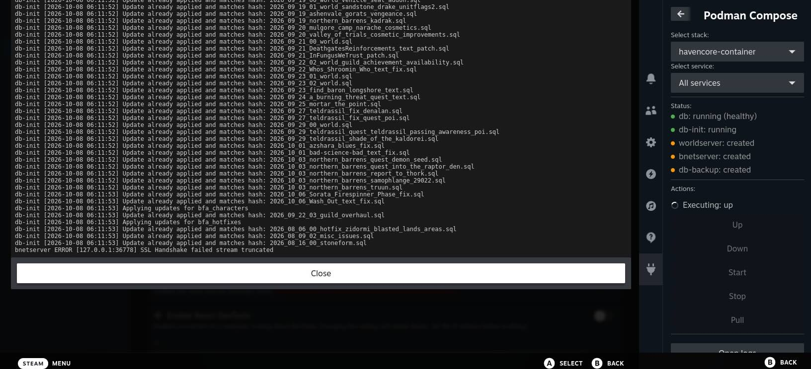

# Decky Podman Compose

A Decky Loader plugin for managing Podman Compose stacks on SteamOS.



## Support

This plugin is maintained primarily for personal use. 

- **GitHub Issues are turned off** and will not be accepted.
- **Pull Requests are welcome** and will be accepted if they are useful and do not add maintenance burden.

## Features

- Discover compose stacks under a configurable base directory
- Inline directory browser for picking the base directory
- Select a stack and optionally a single service
- Up / Down / Start / Stop / Pull whole stacks or individual services
- Live, scrollable logs with per-service tabs and an Action output tab
- Live container stats page showing CPU, memory, network, and block I/O usage
- Status indicator with color-coded health (green / yellow / red)
- Handles one-shot init containers that exit cleanly without showing the stack as partial

## Stacks directory layout

Set the **Stacks directory** in the plugin settings (e.g. `~/podman`).

Each stack must live in its **own subdirectory** under that base directory. The name of the subdirectory is used as the stack name in the plugin.

Example layout:

```
~/podman/
├── web/
│   └── container-compose.yml
├── minecraft/
│   └── container-compose.yml
│   └── container-compose.override.yml
└── database/
    └── docker-compose.yml
```

## Supported compose files

Inside each stack subdirectory, the plugin looks for one of the following compose files:

1. `docker-compose.yml`
2. `podman-compose.yml`
3. `container-compose.yml`

Override files (e.g. `container-compose.override.yml`) are merged automatically by `podman compose` because commands run from the stack's own directory.

## Install

1. Make sure [Decky Loader](https://deckyloader.org/) is installed on SteamOS.
2. Download the latest `decky-podman-compose-<VERSION>.zip` from the [Releases](../../releases) page.
3. In Game Mode, open the Quick Access Menu by pressing the **`...`** button.
4. Open **Decky Loader → Settings → General** and toggle on **Developer Mode**.
5. Switch to the **Developer** tab and select **Install Plugin from ZIP File**.
6. Browse to the downloaded ZIP and install it.
7. The plugin will appear in the Decky plugin list.

> [!NOTE]
> This plugin ships with `podman-compose` bundled, so no separate `podman-compose` install is required.
> `podman` is already installed by default on SteamOS and is used from `PATH`.
>
> To use a custom `podman-compose` binary instead, set `DECKY_PODMAN_COMPOSE_PATH` in your login shell profile (e.g. `~/.bash_profile` or `~/.profile`):
>
> ```bash
> export DECKY_PODMAN_COMPOSE_PATH=/path/to/your/podman-compose
> ```
>
> The plugin reads the login shell environment at startup, so `.bashrc` is not sourced.

## Logs and Action output

Open the logs page for a stack to view:

- **All** — combined logs from every service in the stack
- One tab per service — logs for just that service
- **Action** — the live stdout/stderr of the most recent `up`, `down`, `start`, `stop`, or `pull` command for that stack

The Action tab updates while the command is running, so you can follow a long `pull` or `up` without leaving the plugin.

## Stats

The **Stats** button opens a full-screen stats page for the selected stack. It polls `podman stats` every second and shows a spreadsheet of running containers with:

- Name
- CPU usage and a small sparkline graph
- Memory percentage and a small sparkline graph
- Memory usage
- Network I/O
- Block I/O
- Process count

Only currently running containers are shown; stopped or one-shot containers are excluded.

## Status colors

Each service shows a colored dot based on its current state and health check:

- **Green** — `running`, `healthy`, or `completed`
- **Yellow / Orange** — `created`, `starting`, or `partial`
- **Red** — `stopped`, `failed`, `unhealthy`, or `unknown`

Health checks take precedence over state. For example, a container whose state is `running` but whose health check reports `unhealthy` will show red; a container with health `starting` will show orange.

## License

MIT. See LICENSE.
